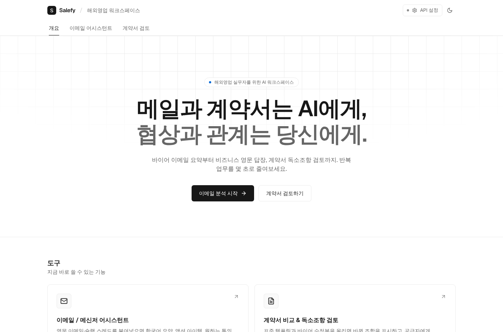
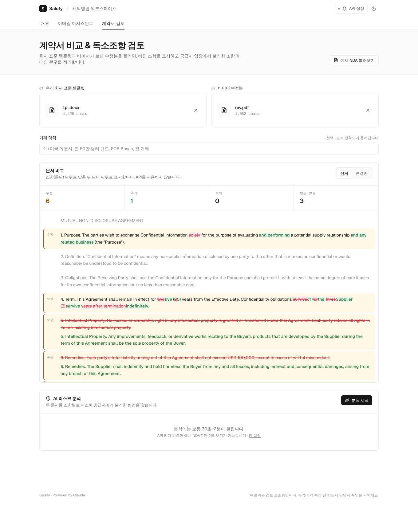
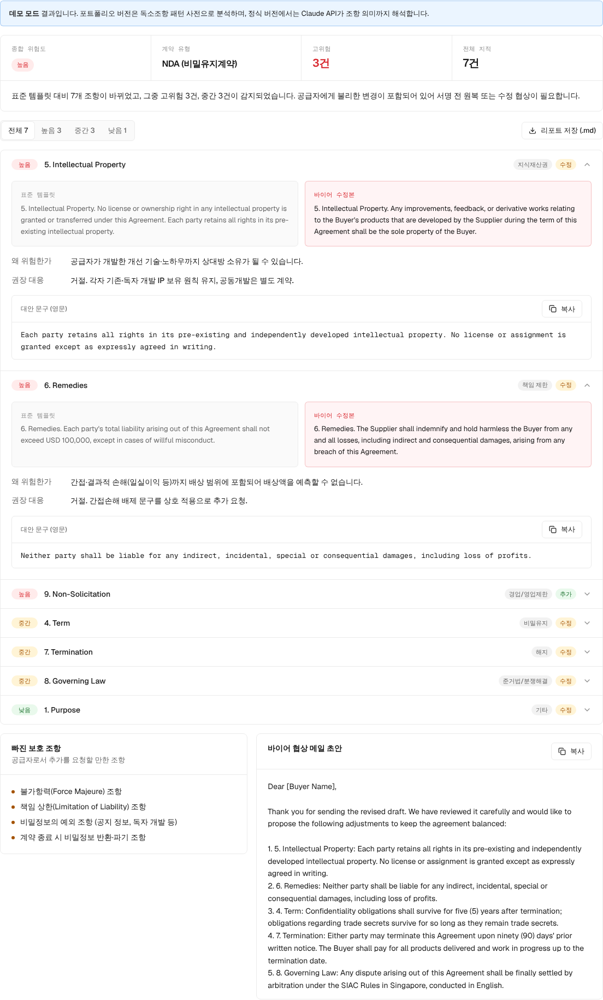
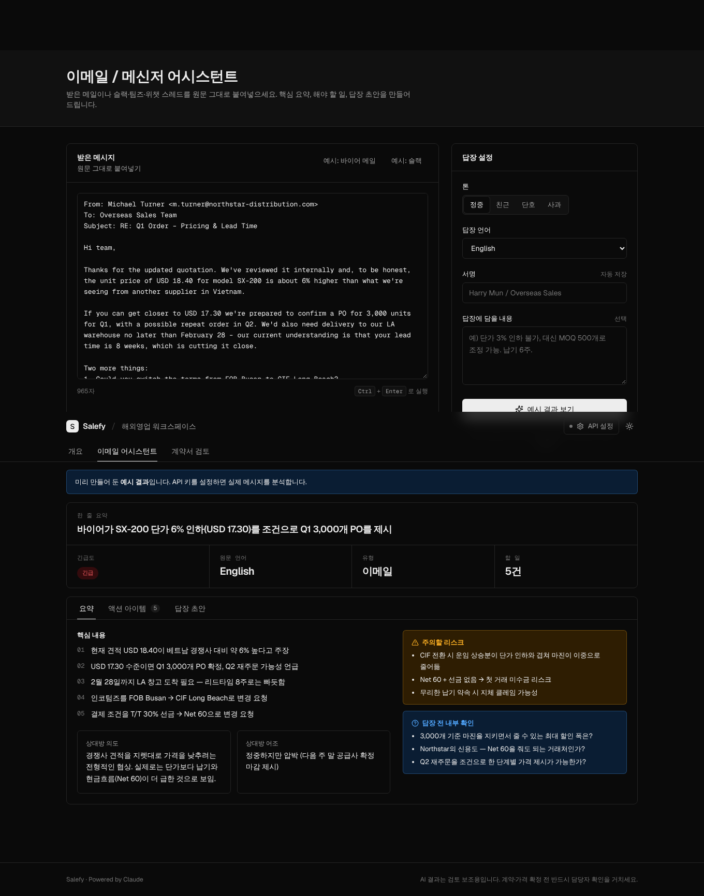

# Salefy · 해외영업 AI 워크스페이스 (Next.js)

Vercel에 바로 배포할 수 있는 Next.js 버전입니다. 기능은 Streamlit 프로토타입과 같습니다.

- **이메일 / 메신저 어시스턴트** (`/email`): 영문 이메일·슬랙 스레드 → 한국어 요약, 의도, 긴급도, 액션 아이템, 리스크, 8개 언어·4가지 톤의 답장 초안 (+한국어 번역)
- **계약서 비교 & 독소조항 검토** (`/contract`): 표준 템플릿 vs 바이어 수정본(PDF/DOCX/TXT) → 조항 단위 레드라인(즉시, API 불필요) + 공급자 관점 위험 조항·권장 대응·영문 대안 문구·협상 메일, Markdown 리포트 저장

라이트/다크 모드, 모바일 화면을 지원합니다.

### 데모 모드 (기본값)
포트폴리오용으로 **외부 API를 호출하지 않고** 동작합니다. `ANTHROPIC_API_KEY`가 없으면 자동으로 데모 모드가 됩니다.
- 이메일: 문장 단위 규칙(요청 표현, 기한·가격·불만 신호)으로 요약·액션 아이템·긴급도를 뽑고, 톤별 템플릿으로 답장 초안 생성 (`lib/mock.ts`)
- 계약서: 조항 diff + 공급자 관점 독소조항 패턴 사전(간접손해, 포괄 면책, 지체상금, 장기 결제, 일방 해지, IP 귀속, 외국 관할, 경업금지 등 14종)으로 위험도·대안 문구 제시
- 예시 데이터(바이어 메일, 예시 NDA)는 Claude로 만든 고품질 결과를 보여줍니다 (`lib/demo.ts`)

환경변수에 `ANTHROPIC_API_KEY`를 넣으면 같은 화면이 Claude API(`lib/claude.ts`) 분석으로 바뀝니다.

## 로컬 실행

```bash
npm install
# (선택) cp .env.example .env.local 후 ANTHROPIC_API_KEY 입력 → 실제 Claude 분석
npm run dev                    # http://localhost:3000
```


## Vercel 배포

1. 이 폴더를 GitHub 저장소에 올립니다.
2. https://vercel.com/new 에서 저장소를 Import (Framework: Next.js 자동 인식)
3. Deploy (데모 모드는 환경변수 불필요. 실제 AI 분석을 켜려면 `ANTHROPIC_API_KEY` 추가)

> 계약서 분석은 30초~2분 걸릴 수 있습니다. `app/api/contract/route.ts`의 `maxDuration = 300`이 플랜의 함수 최대 실행시간 안에 들어가는지 확인하세요.
> 서버 환경변수에 키를 넣으면 사이트에 접속한 누구나 그 키로 호출할 수 있습니다. 외부에 공개할 때는 Vercel의 Password Protection이나 로그인 기능을 추가하세요.

## 구조

```
app/
  page.tsx                 홈 (도구 목록)
  email/page.tsx           이메일 어시스턴트 화면
  contract/page.tsx        계약서 비교 화면
  api/email/route.ts       Claude 호출: 이메일 분석
  api/contract/route.ts    Claude 호출: 계약서 검토
  api/extract/route.ts     PDF/DOCX/TXT 텍스트 추출
lib/
  claude.ts                Claude 공통 래퍼 (구조화 출력, 오류 처리, 거절 시 자동 폴백)
  schemas.ts               입출력 스키마 (zod)
  prompts.ts               시스템 프롬프트
  diff.ts                  조항 단위 diff
  modules.ts               홈/메뉴에 보일 기능 목록
  demo.ts, samples.ts      예시 데이터와 미리보기 결과
components/                UI 컴포넌트 (Geist 폰트, 라이트/다크 토큰)
```

기본 모델은 `claude-opus-5-5`이고, 환경변수 `SALEFY_MODEL`로 바꿀 수 있습니다.

### 새 기능 추가
1. `lib/schemas.ts`에 출력 스키마, `lib/prompts.ts`에 프롬프트 추가
2. `app/api/<기능>/route.ts`에서 `structuredCall()` 호출
3. `app/<기능>/page.tsx` 화면 작성 후 `lib/modules.ts`에 `href` 등록, `components/header.tsx`의 `NAV`에 추가

## 스크린샷

| 홈 | 계약서 비교 |
|---|---|
|  |  |
| **독소조항 분석** | **이메일 어시스턴트 (다크)** |
|  |  |
